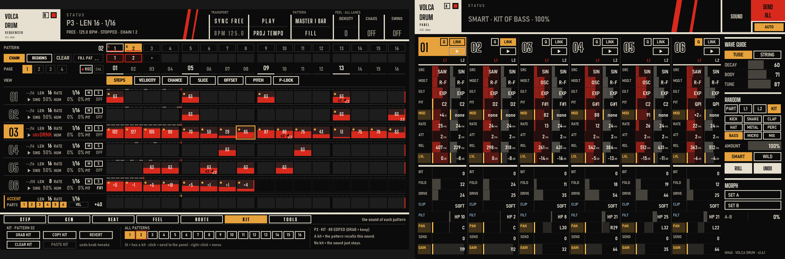
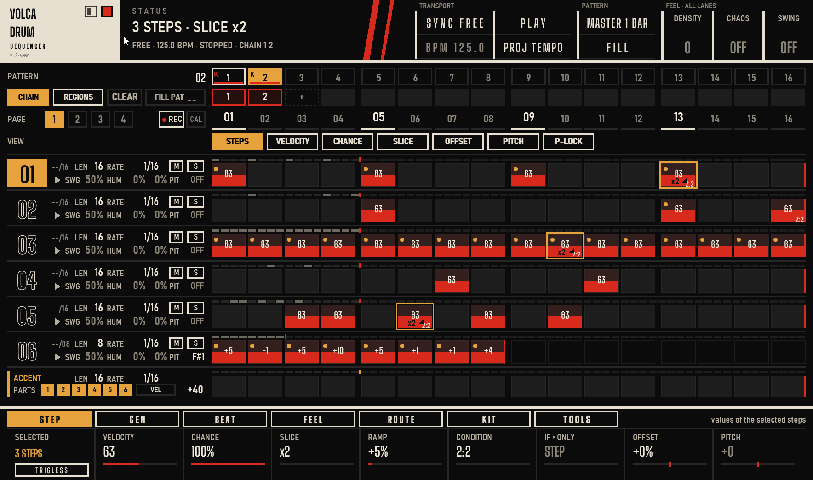
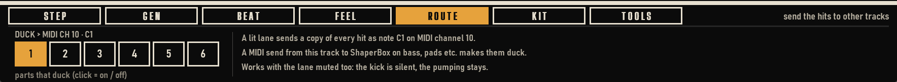
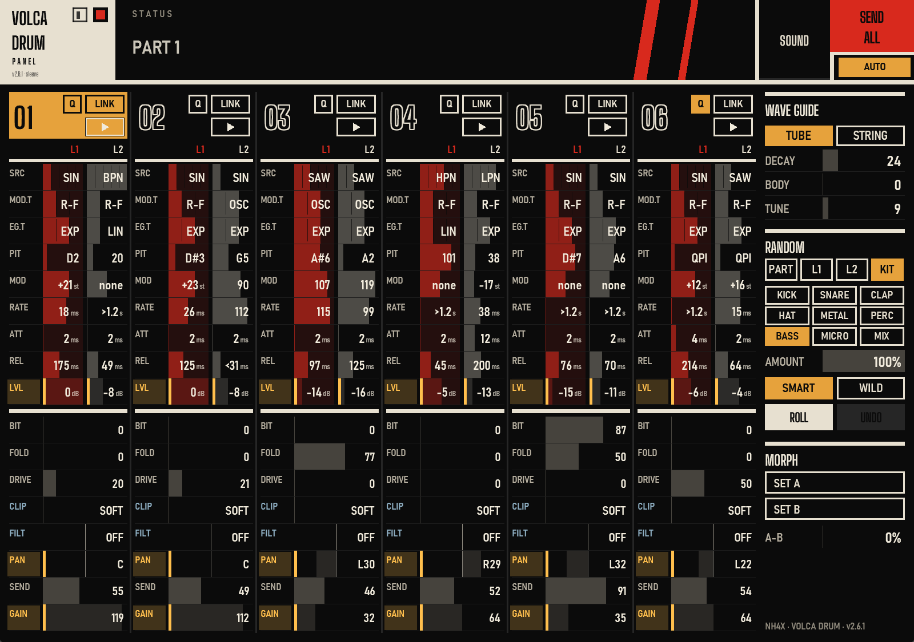
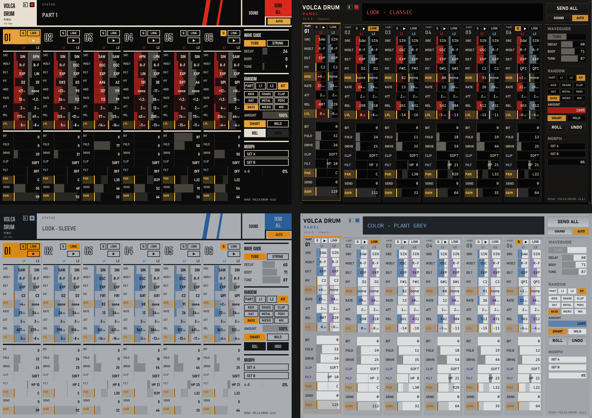

# NH4X Volca Drum Suite

**Your Korg volca drum, fully inside REAPER.** A step sequencer and a full editor panel, free, two plugins, no extra software.

  <a href="sequencer.md"><b>Sequencer manual</b></a> ·
  <a href="panel.md"><b>Panel manual</b></a> ·
  <a href="actions.md"><b>Actions</b></a> ·
  <a href="../README.md#install-under-5-minutes-do-it-once"><b>Install</b></a> ·
  <a href="https://youtu.be/e6BRPumwCv8"><b>Install video</b></a>

---

## The sequencer

**6 lanes × 64 steps, 16 patterns, made for the six volca parts.** Think classic drum machine, plus the tricks of the big grooveboxes.

- **Polymeter.** Every lane has its own length, rate, direction, swing and humanize. A 7-step perc against a 16-step kick never repeats the same way.
- **Conditions.** 1:2, 4:4, 1ST, FILL, PRE, NEI and more, plus chance per step. Turnarounds and fills come by themselves.
- **P-locks.** Any panel parameter per step: a lower kick on 13, a dirty last snare, hat decay painted across the bar. **Random ranges** roll a new value on every hit. **Trigless steps** change a sound while it rings.
- **Rolls and ramps.** Up to 8 hits in a step, or rhythmic figures, fading in or out.
- **Melodic lanes.** Kick basslines and tuned toms, note by note.
- **Accent row.** One accent track for the whole kit with its own length: the push walks through a loop that never changes. Accents can add drive, bit crush or an octave, not just volume.
- **Beat generator.** 28 styles, from old EBM, futurepop and rhythm noise to techno, house, breakbeat, DnB, trap, funk, bossa nova and swing. One click, a full groove.
- **Feel knobs.** CHAOS loosens everything, DENSITY thins out or fills up, EVOLVE changes a little every few bars, 8 groove templates. Turn them back and the pattern is clean.
- **Song mode.** Chains, a fill pattern, auto fill every n bars, and **regions = patterns**: name a region "P2 Chorus" and the song follows your arrangement.
- **Kit per pattern.** A pattern brings its own sound: verse kit, drop kit, switched on the bar.
- **Tap record** from your MIDI pads, with timing calibration.

---

## Pump the whole mix

**Sidechain ducking from the sequencer, set up in one click.** Switch DUCK on for the kick lane, select your bass and pad tracks, run **Volca duck to selected tracks**: the routing is done. Add a ducking plugin that listens to MIDI and the tracks pump with every kick.

- **Ghost ducking:** mute the kick and the pump keeps going.
- Any lane can trigger: kick, hats, perc. Rolls, chance and conditions apply.
- Automate it: pump only in the chorus.
- Works for any track in the project, not just the volca.

[How to set it up](actions.md#volca-duck-to-selected-tracks)

---

## The panel

**Every parameter of all six parts and the waveguide on one screen.** No menu diving on a tiny display.

- **Real units.** Level in dB, attack and release in ms, pitch in Hz and note name (`G#1`), sweeps in semitones. Measured on a real volca drum.
- **SMART randomize.** Pick a kind (kick, snare, clap, hat, metal, perc, bass, micro) and roll: you get a usable sound of that kind, not noise. **MIX** rolls a whole drum kit. Low amount = variations of the sound you have.
- **Locks.** Keep a value, a row or a whole part out of every roll.
- **Morph.** Set two kits as A and B and blend between them with one fader.
- **Kits and sounds.** Kits are REAPER presets. Single drums are saved as sound files, grouped by name, shared by all projects. Copy a kick from one kit into another in two clicks.
- **Undo** for rolls, pastes, kit loads and morphs.
- **vdcf firmware ready.** Filter and clip of the free vdcf custom firmware right in the panel. Everything else works on the stock firmware too.
- **Automation and MIDI controllers.** Every control is a plugin parameter.

---

## Made to look like hardware

Two looks, **Sleeve** (flat, record-sleeve style) and **Classic** (gunmetal hardware), and 14 color themes for both. Sequencer and panel match. Above: Sleeve and Classic in Sleeve red (top) and Plant grey (bottom).

---

## Get it

Free, via ReaPack. Install in under 5 minutes: [step by step](../README.md#install-under-5-minutes-do-it-once) or [watch the video](https://youtu.be/e6BRPumwCv8).

By **NH4X** · Music: https://nh4x.bandcamp.com/ · License: CC BY-NC-SA 4.0. Your music is yours.
