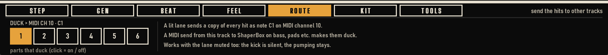

# Volca Actions · User Manual

Part of the **NH4X Volca Drum Suite** · [Overview](README.md) · [Sequencer manual](sequencer.md) · [Panel manual](panel.md)

The suite comes with a few REAPER actions. Find them in **Actions > Show action list**: search for **volca**.

**The one you'll use:** [Volca duck to selected tracks](#volca-duck-to-selected-tracks) makes bass, pads or any other track pump to your drums.

The rest run in the background or are shortcuts for keys and MIDI controllers:

| Action | What it does |
|---|---|
| [**Volca duck to selected tracks**](#volca-duck-to-selected-tracks) | **Other tracks duck to the sequencer's hits, sidechain style** |
| [Volca listener (start)](#volca-listener-start) | Background helper for sound files and regions. Run once at install |
| [Volca kit (save)](#volca-kit-actions) | Save the panel as a new kit |
| [Volca kit (kit +) / (kit -)](#volca-kit-actions) | Next / previous kit |
| [Volca kit (send all)](#volca-kit-actions) | Send the whole kit to the volca |
| [Volca sound (save) / (load)](#volca-sound-actions) | Save / load the focused part as a sound file |

Any action can go on a key, a toolbar button or a MIDI controller: select it in the action list and click **Add…** under *Shortcuts for selected action*.

---

## Volca duck to selected tracks

**Pump without an audio sidechain.** Your kick ducks the bass, the pads, the whole synth bus, and it keeps pumping even when the kick is muted.

### How it works
Every hit of a lane with **DUCK** on also sends a short trigger note (C1 on MIDI channel 10). This action routes that trigger to the tracks you select. A plugin on each of those tracks ducks the volume when the trigger comes in. The volca ignores channel 10, so it doesn't hear the trigger.

### Set it up
1. **Pick the trigger lanes.** In the sequencer, open the **ROUTE** tab and switch **DUCK** on for the lanes that should pump the others, usually lane 1 (kick).
2. **Select the tracks that should duck** in REAPER (bass, pads, a bus … several at once is fine).
3. **Run Volca duck to selected tracks.** Each selected track gets a MIDI receive from the sequencer track: MIDI channel 10 → bus 2, no audio. A message lists what was added.
4. **Add a ducking plugin** on each of those tracks, one that ducks on MIDI notes, and set its MIDI input to **bus 2**.
   Example ShaperBox 3 (VST3): MIDI input **Bus 2**, and in the plugin's pin menu (the **2 in 2 out** button in the FX window) turn on *Map REAPER MIDI buses to VST3 MIDI buses*. Volume shaper trigger: MIDI.
5. Press play: the tracks pump with the kick.

### Change or remove it
- **Remove:** select the track and run the action again. The receive is removed (toggle per track). Other sends and receives stay as they are.
- **Different lanes:** change the DUCK buttons in the ROUTE tab. No new routing needed.
- **Duck only in some parts of the song:** automate the sequencer's **Duck** parameter, e.g. pump only in the chorus.

### Tricks
- **Ghost ducking:** mute the kick lane (M). The kick is gone, the pump stays. Great for breakdowns.
- **Duck from the hats or a perc lane** instead of the kick for a faster, off-beat pump.
- Rolls duck on every hit, and chance, conditions, groove and chaos apply to the trigger too.
- **Works without the volca:** the sequencer can drive the pumping of any project as a pure trigger sequencer.

### If nothing pumps
| Problem | Fix |
|---|---|
| Message: no track with the Volca Drum Sequencer found | Add the sequencer to a track first. |
| Message: select the tracks first | Select the tracks that should duck, then run the action. |
| The ducking plugin doesn't react | Its MIDI input must be bus 2. For VST3 plugins: turn on *Map REAPER MIDI buses to VST3 MIDI buses* in the pin menu. |
| Still nothing | Is DUCK on for a lane that plays? Is the lane playing hits right now (not muted by a condition)? |

---

## Volca listener (start)

A small helper that runs in the background. It does what a plugin can't: write files and read region names.

**Needed for:** the panel's SOUND menu **SAVE / RENAME / DELETE** and the sequencer's **REGIONS** button. Everything else works without it.

1. Run **Volca listener (start)** once.
2. It asks if it may start with REAPER from now on: click **Yes**.

From then on it starts with REAPER by itself. Click **No** and it runs until you close REAPER. Running it again restarts it.

---

## Volca kit actions

Kits are REAPER presets of the panel. These actions work on the panel of the focused FX window (or the first selected track). Put them on keys or controller buttons to switch kits live.

| Action | What it does |
|---|---|
| **Volca kit (save)** | Saves the panel as a new preset `Kit 001`, `Kit 002` … (the next free number). Rename it in REAPER's preset menu. |
| **Volca kit (kit +)** | Loads the next kit (wraps around). |
| **Volca kit (kit -)** | Loads the previous kit (wraps around). |
| **Volca kit (send all)** | Sends the whole kit to the volca, same as **SEND ALL** in the panel. |

The panel's readout shows what happened: `KIT · Kit 003`, `KIT SAVED · Kit 004`, `SENT ALL`.

If a new kit doesn't load from the preset menu right after saving, close and reopen the FX window.

---

## Volca sound actions

A sound is one part of the panel, saved as a file. These actions work on the **focused part** (click its title in the panel first). The panel's **SOUND** menu does the same; the actions are for keys and controllers.

| Action | What it does |
|---|---|
| **Volca sound (save)** | Asks for a name and saves the focused part as a sound. |
| **Volca sound (load)** | Opens the sound list at the mouse and loads the chosen sound into the focused part. |

Sound files are shared by all projects. They live in REAPER's resource folder under `Data/NH4X Volca/VolcaSounds`.
