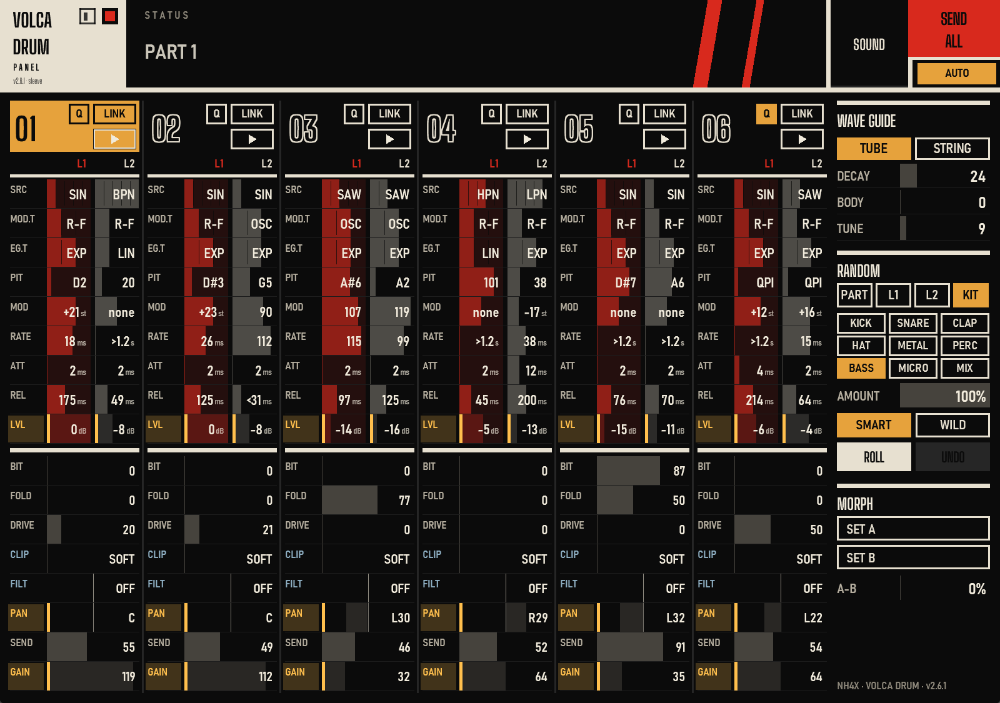
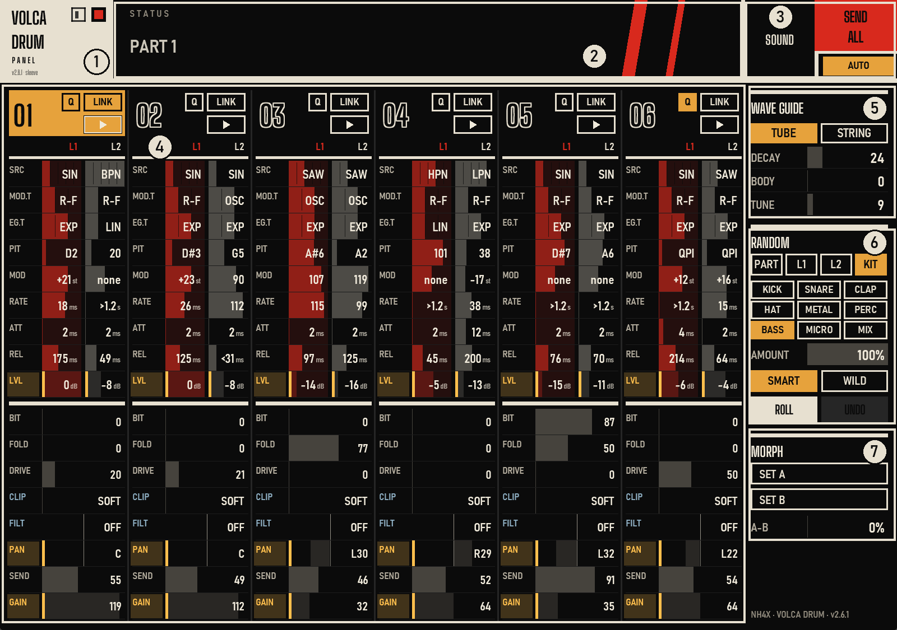
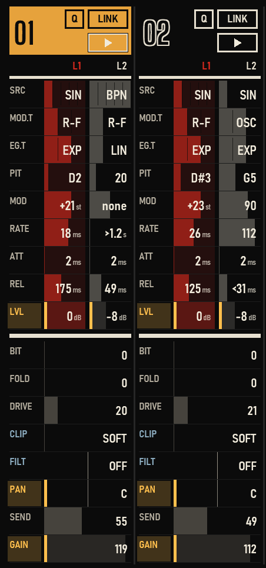
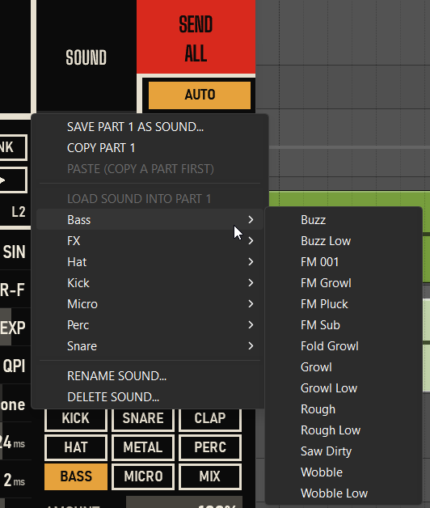
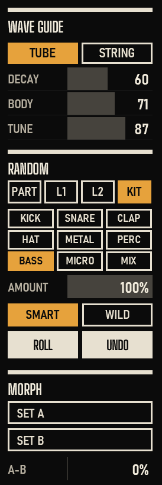

# NH4X Volca Drum Panel · User Manual

Part of the **NH4X Volca Drum Suite** · [Overview](README.md) · [Sequencer manual](sequencer.md) · [Actions](actions.md)

An editor for the Korg volca drum, inside REAPER. Every parameter of all six parts and the waveguide on one screen, in real units, with kits, sound files, smart randomize and morph.

## Contents

1. [Quick start](#quick-start)
2. [The window at a glance](#the-window-at-a-glance)
3. [Top bar](#top-bar)
4. [Parts](#parts)
5. [Waveguide](#waveguide)
6. [Kits and sounds](#kits-and-sounds)
7. [Randomize](#randomize)
8. [Locks](#locks)
9. [Morph](#morph)
10. [Playing the panel without the sequencer](#playing-the-panel-without-the-sequencer)
11. [Reference](#reference)
12. [Troubleshooting](#troubleshooting)

---

## Quick start

You have installed the suite and set up the track as described in the [README](../README.md#install-under-5-minutes-do-it-once).

1. Open the panel's FX window and press **SEND ALL**: the volca now has the panel's sound.
2. Press the **play button** in a part header: you hear one hit of that part.
3. Drag a bar up or down (or use the mouse wheel). The big readout shows the value in real units.
4. In **RANDOM**, pick **KIT**, kind **MIX** and press **ROLL**: a whole new drum kit. **UNDO** takes it back.
5. Like the kit? Save it with REAPER's preset menu at the top of the FX window (**+** > Save preset).

> [!TIP]
> Rest the mouse for a second on a button: the readout says what it does.

---

## The window at a glance

| # | Area | What it holds |
|---|---|---|
| 1 | **Title block** | Name, version, LOOK and COLOR icons |
| 2 | **Readout** | The last changed parameter, its value in full, messages |
| 3 | **SOUND · SEND ALL · AUTO** | Sound files, send the kit, auto send on load |
| 4 | **Parts 1-6** | Header, layer 1, layer 2, mix rows |
| 5 | **Waveguide** | The volca's waveguide resonator |
| 6 | **RANDOM** | Smart and wild randomize |
| 7 | **MORPH** | Blend between two snapshots |

**LOOK** (half-filled square) switches between the **Sleeve** and the **Classic** look. **COLOR** (swatch next to it) picks one of 14 color themes: click or right-click = list, wheel = next. Both are saved with the project and in presets.

---

## Top bar

| Control | What it does |
|---|---|
| **SOUND** | Sound menu for the focused part: save, copy, paste, load, rename, delete. See [Kits and sounds](#kits-and-sounds). |
| **SEND ALL** | Sends the whole kit to the volca. The volca has no MIDI out, so the panel only knows what it sent: press this when the volca was switched on late. |
| **AUTO** | Lit (default) = the panel sends the whole kit once when the project loads, so the volca is back on the saved sound. |

---

## Parts

Each of the six parts is one column. The volca builds every part from **two layers** (L1, L2), then a mix section.

### Part header
| Control | What it does |
|---|---|
| **Title** (PART 01 … / the big number) | Click = select the part (for SOUND, RANDOM). Right-click = sound menu. Shift+click = lock the whole part. |
| **Q** | Pitch quantize (QPI) on / off: the part plays incoming notes chromatically. Switched by the sequencer when a lane uses PIT. Q off = back to the PITCH value. |
| **▶** | One test hit of this part. |
| **LINK** | A change on one layer goes to the other layer too (also for the sequencer's p-locks). |

### Layer rows (L1 and L2)
| Row | Parameter | Shown as |
|---|---|---|
| **SRC** | Sound source: SIN, SAW, HPN, LPN, BPN (sine, saw, high-pass / low-pass / band-pass noise) | name |
| **MOD.T** | Modulation type: rise-fall, oscillate, random | name |
| **EG.T** | Envelope type: linear, exponential, multi-peak | name |
| **PIT** | Pitch | nearest note (`G#1`, the readout adds Hz + cents). With Q on: `QPI` |
| **MOD** | Modulation amount | rise-fall: sweep in semitones (`+21st`), `none` = no sweep |
| **RATE** | Modulation rate | rise-fall: ms until the sweep is halfway back |
| **ATT** | Attack | ms to peak |
| **REL** | Release | ms until −40 dB (`click` for very short) |
| **LVL** | Level | dB (`-6dB`), 0 = off |

SRC, MOD.T and EG.T are the three parts of the volca's single Select parameter. Each row changes only its own part. Click a segment, drag or use the wheel.

The units were measured on a volca drum, so they are close, not exact. Noise pitch (that's a filter cutoff), oscillate / random modulation and the mix rows stay 0-127. Typing a number always means the 0-127 value.

**Kick zone:** MOD 80-96 with RATE 64-80 = a sweep of +15 … +40 semitones that drops in 10-30 ms.

### Mix rows
| Row | Parameter |
|---|---|
| **BIT** | Bit reduction |
| **FOLD** | Wave folder |
| **DRIVE** | Overdrive |
| **CLIP** | Clipper, soft or hard (vdcf firmware) |
| **FILT** | Filter: `LP` below the middle, `OFF` in the middle, `HP` above (vdcf firmware) |
| **PAN** | Pan: `L` · `C` · `R` |
| **SEND** | Send to the waveguide |
| **GAIN** | Part gain |

**FILT** and **CLIP** (purple row names) need the free custom firmware **vdcf** by hj-oja: https://github.com/hj-oja/vdcf. On the stock firmware they do nothing; everything else works.

### Changing values
| Action | How |
|---|---|
| Change | Drag up / down or mouse wheel on the bar |
| Default | Double-click or Alt+click the bar |
| Exact value | Hover the bar, type 0-127, Enter |
| Read a value | Click it: the readout shows the full name and the long value (e.g. `53 Hz · G#1 +36c`) |

---

## Waveguide

The volca's resonator, shared by all parts. Each part feeds it with its **SEND** row.

| Row | Parameter |
|---|---|
| **TUBE / STRING** | Resonator model |
| **DECAY** | How long it rings |
| **BODY** | Tone of the resonator |
| **TUNE** | Pitch of the resonator |

Click **WAVEGUIDE** to select it as the target for RANDOM.

---

## Kits and sounds

### Kits
A **kit** = the whole panel (all six parts + waveguide) = a **REAPER preset** of the panel.

- **Save / load / rename / delete:** REAPER's preset menu and **+** button at the top of the FX window.
- Loading a kit sends the changes to the volca.
- Kits are global: every project sees the same list. To share kits, export them as a preset library (`.rpl`) from the **+** menu.
- For keys or a MIDI controller: the actions **Volca kit (save)**, **(kit +)**, **(kit -)**, **(send all)**. See [Actions](actions.md).
- The sequencer can store a kit per pattern, see the [sequencer's KIT tab](sequencer.md#kit).

### Sounds
A **sound** = one part (both layers + mix rows), saved as a file. Sounds are global and shared by all projects.

Click a part title to select it, then **SOUND** (or right-click the part title):

| Item | What it does |
|---|---|
| **SAVE PART n AS SOUND** | Asks for a name and saves the part as a sound file |
| **COPY / PASTE** | Copy a part, paste it on another part or into another kit |
| **LOAD SOUND** | The sound list, grouped by the first word of the name |
| **RENAME / DELETE** | Rename or delete a sound file (deleted files go to a `Deleted` subfolder) |

SAVE, RENAME and DELETE need the listener (action **Volca listener (start)**). COPY, PASTE and LOAD always work.

**Groups:** start sound names with a group word: `Kick Punchy`, `Snare Metal`, `Hat Closed`. The LOAD list then has a **Kick**, **Snare**, **Hat** … submenu. Words used only once go into **More**.

**Move a drum to another kit:** select the part → SOUND > COPY → load the other kit → select the target part → SOUND > PASTE → save the kit.

Sound files live in REAPER's resource folder under `Data/NH4X Volca/VolcaSounds`.

---

## Randomize

| Control | What it does |
|---|---|
| **PART / L1 / L2 / KIT** | Target: the focused part (or the waveguide), one layer of it, or the whole kit |
| **Kind** | What SMART rolls: KICK · SNARE · CLAP · HAT · METAL · PERC · BASS · MICRO · MIX. Clicking a kind also switches to SMART |
| **AMOUNT** | How far from the current sound. 100 % = brand new, low = a variation |
| **SMART / WILD** | SMART = a sound of the chosen kind, inside its useful ranges. WILD = anything, full range |
| **ROLL** | Rolls the target. The readout says what came out, e.g. `SMART · HAT FM · PART 3 · 50%` |
| **UNDO** | Back to before the last roll, paste, sound load, kit load or morph. Press again = redo |

### SMART kinds
Each kind has a few sound families. A roll picks one and keeps every value inside the range that works for that sound.

| Kind | Families |
|---|---|
| **KICK** | PUNCH (fast pitch drop + click layer) · ROUND (low body, soft drop, noise beater, fold + drive) |
| **SNARE** | BODY (sine + noise) · INDUSTRIAL (saw + band-pass noise, driven) |
| **CLAP** | MULTI (multi-peak noise) |
| **HAT** | NOISE (closed or open) · FM (FM sizzle + noise) |
| **METAL** | FM CLANG · FOLD CLANG |
| **PERC** | TOM · RIM · COWBELL · BELL |
| **BASS** | FM (+ sub) · SAW (+ sub) |
| **MICRO** | BLIP · ZAP · TICK · PING |
| **MIX** | On KIT: a whole drum kit (kick, snare, closed hat, open hat or metal, clap, perc). On a part: one random kind |

- **AMOUNT below 50 %** keeps the family: an FM hat stays an FM hat, only the details move.
- **KIT + a kind** = all six parts of that kind: six hats or six micro sounds = a chatter kit.
- The **FM** families need **FM on** for that part, set on the volca itself (vdcf firmware: EDIT/STEP > SELECT to FM). Without it they turn into LFO wobbles.
- With **LINK** on, both layers get the same new value.

---

## Locks

Locked values are skipped by every roll and by morph. Locks show in **amber**.

| Click | Locks / unlocks |
|---|---|
| **Right-click a bar** (or Shift+click) | That one value |
| **Click a row name** (SRC, PIT …) | That row in this part, both layers |
| **Right-click a row name** | That row in all six parts |
| **Shift+click a part title** | The whole part |

By default **LVL**, **PAN**, **GAIN** and **FILT** are locked in every part, so rolls keep your balance and never filter a part to silence. Unlock LVL to let SMART set the layer balance too, e.g. a quiet click layer on a kick.

Locks are saved with the project, not in kits.

---

## Morph

1. Load or build kit A and press **SET A**.
2. Load or build kit B and press **SET B**.
3. Move the **A-B** bar: 0 % = A, 100 % = B.

SET A / SET B show the kit name (`*` = edited). Select rows and the waveguide MODEL switch at 50 %. Locked values don't move. Morph between saved kits: a random roll can't be brought back once it's gone. A and B are saved with the project.

---

## Playing the panel without the sequencer

- Notes **65 / 67 / 69 / 71 / 72 / 74** on **any** channel play part 1-6, so one piano roll on one channel plays all parts.
- Notes on **channels 11-16** go to part 1-6 unchanged: play a part melodically from a keyboard (best with **Q** on).
- All other MIDI passes through.

---

## Reference

### Plugin parameters
Every control is a plugin parameter: automation and MIDI controllers work.

| # | Parameter |
|---|---|
| 1-22 | Part 1: L1 Select, Level, EG Attack, EG Release, Pitch, Mod Amount, Mod Rate · L2 the same · Pan, Bit, Fold, Drive, Gain, WG Send, Filter, Clip |
| 23-132 | Parts 2-6, same order (part n starts at (n−1) × 22 + 1) |
| 133-136 | Waveguide Model, Decay, Body, Tune |
| 137 | Send all |
| 138-143 | Link L1+L2, part 1-6 |
| 144 / 145 | Random amount / target |
| 146 / 147 | Roll / Undo (set to 1 = fire, resets to 0) |
| 148 | Morph A > B |
| 149 / 150 | Color / Look |
| 151-156 | Q (QPI), part 1-6 |
| 157 | Auto send on load |
| 158 / 159 | Random mode (Smart / Wild) / kind |
| 160-195 | Each Select row (SRC / MOD.T / EG.T) per part and layer as its own parameter |

### MIDI
Part n sends on MIDI channel n. The waveguide sends on channel 1.

| Parameter | L1 CC | L2 CC |
|---|---|---|
| Select | 14 | 15 |
| Level | 17 | 18 |
| EG Attack | 20 | 21 |
| EG Release | 23 | 24 |
| Pitch | 26 | 27 |
| Mod Amount | 29 | 30 |
| Mod Rate | 46 | 47 |

| Parameter | CC | | Parameter | CC |
|---|---|---|---|---|
| Pan | 10 | | Filter (vdcf) | 54 |
| Bit reduction | 49 | | Clip (vdcf) | 55 |
| Fold | 50 | | QPI (Q) | 53 |
| Drive | 51 | | WG Model | 116 |
| Gain | 52 | | WG Decay | 117 |
| WG Send | 103 | | WG Body | 118 |
| | | | WG Tune | 119 |

The panel also uses CC 119 on MIDI channel 16 to talk to the sequencer and doesn't pass it on.

---

## Troubleshooting

| Problem | Fix |
|---|---|
| The volca doesn't follow the panel | Check the track's MIDI hardware output (volca port, *send to original channels*) and that the volca is in split channel mode. Then press **SEND ALL**. |
| The volca sounds different from the panel after power-on | The volca forgets nothing it didn't get: press **SEND ALL**. |
| FILT and CLIP do nothing | They need the vdcf firmware. |
| Readout says `RUN ACTION 'VOLCA LISTENER (START)'` | Run the action **Volca listener (start)** once (see [Actions](actions.md)). |
| A new kit doesn't show in the preset menu | Close and reopen the FX window. |
| A part stays on one pitch | **Q** is on: the part follows incoming notes. Switch Q off. |
| FM sounds from SMART wobble instead of ringing | Switch FM on for that part on the volca (vdcf: EDIT/STEP > SELECT to FM). |
| ROLL doesn't change a row | The row is locked (amber). Click its name to unlock. |
| Fonts look plain in the Sleeve look | Install the free font **Big Shoulders Display** (Google Fonts). Otherwise Bahnschrift is used. |
