# NH4X Volca Drum Sequencer · User Manual

Part of the **NH4X Volca Drum Suite** · [Overview](README.md) · [Panel manual](panel.md) · [Actions](actions.md)

A step sequencer for the six parts of the Korg volca drum, inside REAPER. 6 lanes × 64 steps, 16 patterns, conditions, p-locks, a beat generator and a few knobs that bring a static loop to life.

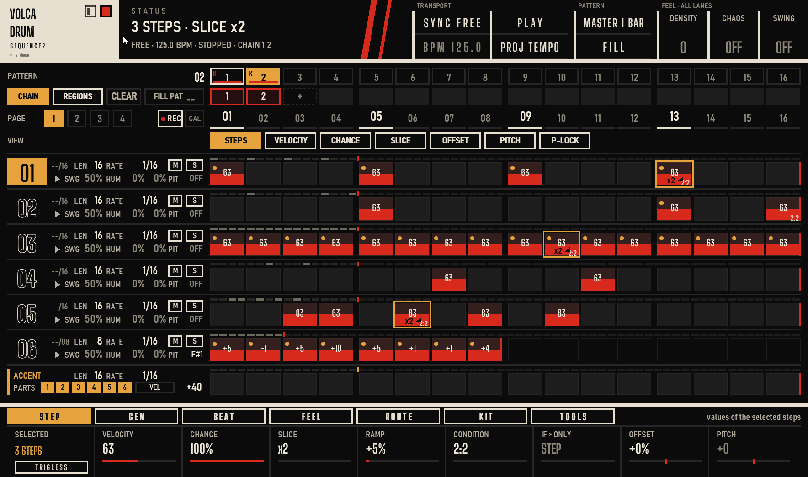

## Contents

1. [Quick start](#quick-start)
2. [The window at a glance](#the-window-at-a-glance)
3. [Header](#header)
4. [Patterns and song](#patterns-and-song)
5. [Lanes and steps](#lanes-and-steps)
6. [View tabs](#view-tabs)
7. [Accent row](#accent-row)
8. [Bottom strip](#bottom-strip)
9. [Tap record](#tap-record)
10. [Reference](#reference)
11. [Troubleshooting](#troubleshooting)

---

## Quick start

You have installed the suite and set up the track as described in the [README](../README.md#install-under-5-minutes-do-it-once): sequencer first, panel after it, MIDI hardware output to the volca, track armed.

1. Open the sequencer's FX window.
2. Click the **BEAT** tab in the bottom strip, pick a **STYLE** (e.g. *EBM*) and press **GENERATE**. All six lanes get a groove.
3. Press play in REAPER. The volca plays the pattern.
4. Click steps to add or remove hits. Mouse wheel on a lit step = velocity.
5. Turn the **CHAOS** box in the header up a little and listen how the loop loosens. Back to 0 = clean again.
6. Save the project: the patterns are saved with it.

> [!TIP]
> Rest the mouse for a second on any control: the readout at the top says what it does.

---

## The window at a glance

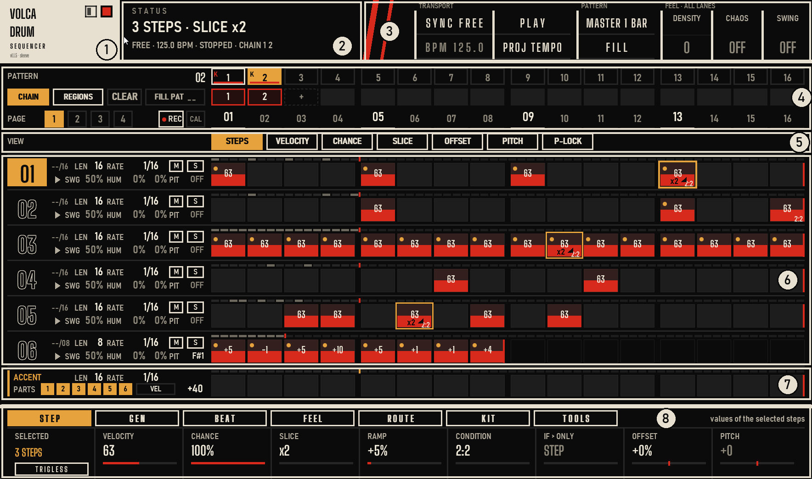

| # | Area | What it holds |
|---|---|---|
| 1 | **Title block** | Name, version, LOOK and COLOR icons |
| 2 | **Readout** | What you just changed, tips, status (CHAIN, REGION, CHAOS …) |
| 3 | **Header** | Transport, master length, fill, density, chaos, swing |
| 4 | **Pattern + song rows** | 16 pattern slots, chain, regions, fill pattern, PAGE, tap record |
| 5 | **View tabs** | What the steps show: on/off or one value as bars |
| 6 | **Lanes 1-6** | Lane strip (part name, length, rate, mute / solo …) + 64 steps |
| 7 | **Accent row** | One accent track for the whole kit |
| 8 | **Bottom strip** | STEP · GEN · BEAT · FEEL · ROUTE · KIT · TOOLS |

**LOOK** (half-filled square) switches between the **Sleeve** and the **Classic** look. **COLOR** (swatch next to it) picks one of 14 color themes: click or right-click = list, wheel = next. Both are saved with the project and in presets.

---

## Header

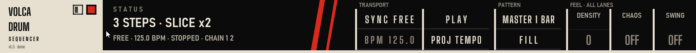

| Control | What it does |
|---|---|
| **SYNC: REAPER / FREE** | **REAPER** = locked to the project position: loops, jumps and renders stay in sync. **FREE** = own PLAY / STOP and tempo, runs while REAPER is stopped (arm the track for smooth timing). |
| **PLAY · BPM · TEMPO** | FREE only: start / stop, own BPM (drag or wheel, right-click = list) or the project tempo. |
| **MASTER** | OFF or ½ / 1 / 2 / 3 / 4 / 8 / 16 bars: all lanes jump back to step 1 together after that time. Keeps odd lane lengths from drifting forever. |
| **FILL** | The fill switch for `FILL` / `NO FILL` steps and the fill pattern. Lights while an AUTO FILL bar plays. Right-click = AUTO FILL list. |
| **DENSITY** | −100 … +100. Minus thins out all lanes (closed hats and ghost notes go first, the kick last), plus adds ghost hits on empty steps. The pattern itself is never changed. |
| **CHAOS** | 0-100 %. One knob that loosens everything: timing and velocity wobble, then dropouts, ghost hits and rolls, at the top steps jump around. Back to 0 = clean. |
| **SWING** | Global swing 50-75 % for all lanes that follow it. 50 % = straight, 66 % = triplet feel, 75 % = dotted. |

All value boxes: drag or mouse wheel to change, right-click = list, double-click or Alt+click = default.

**Performance tips:** automate DENSITY from −60 to 0 over 8 bars for a build-up. Push CHAOS up over the last bar before a drop and back to 0 on the one.

---

## Patterns and song

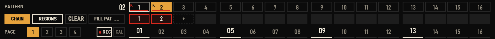

### Pattern row
16 slots, lined up with the step columns. **Red** = current, **light** = has content, **dark** = empty, **blinking** = queued.

- **Click** a slot: while playing it switches at the next bar (or the next MASTER cycle), when stopped at once.
- **Right-click** = pattern menu: copy, paste here, add to chain, use as FILL pattern, clear, reset.
- A small **K** = the pattern has its own kit (see [KIT](#kit)). An orange **F** = the fill pattern.
- Each pattern holds everything: steps and their values, p-locks, lane settings, accent row and kit.

### Song row
| Control | What it does |
|---|---|
| **CHAIN** | On = the chain plays: each entry one bar (or one MASTER cycle), then the next, looping. Right-click = remove last entry / clear chain. |
| **REGIONS** | On = your project regions pick the patterns (see below). Needs SYNC REAPER and the listener. |
| **CLEAR** | Empties the chain (the patterns stay). |
| **FILL PAT** | The pattern that replaces the playing one while FILL is on. Click = list, wheel = next. |
| **Chain slots** | Click **+** and pick a pattern, or **Shift+click** pattern slots to add them. Click or right-click an entry = change or remove it, wheel = change. |

The readout shows the chain with the playing entry in brackets: `CHAIN 1 [1] 2 4`.

### PAGE
A lane has up to 64 steps; the grid shows 16 at a time. **PAGE 1-4** picks which 16 you see and edit (1 = steps 1-16, 2 = 17-32 …). The step numbers above the grid show where you are; every 4th is bold.

**REC** and **CAL** next to it are for [tap record](#tap-record).

### Regions = patterns
Name your arrangement regions **P1 Verse**, **P2 Chorus**, **P7 Drop** … (P + a number 1-16 at the start of the name) and turn **REGIONS** on. While the playhead is inside a region, that pattern plays. Move a region and the pattern change moves with it. Put region starts on bar lines.

Other region names are ignored. Outside P-regions the chain or the selected pattern plays.

### Which pattern plays
**Fill pattern** (while FILL is on) > **region** > **chain** > **selected pattern**.

### Other ways to switch
- A **program change 0-15** on the track (e.g. in a MIDI item) switches to pattern 1-16. Put it a little before the bar line.
- Automate the **Pattern** parameter.

---

## Lanes and steps

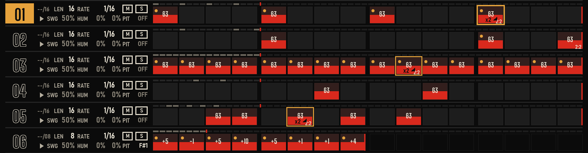

Six lanes = the six volca parts (lane 1 = part 1 on MIDI channel 1 … lane 6 = part 6 on channel 6).

### Lane strip
| Control | What it does |
|---|---|
| **Part name / number** | Click = focus this lane + one test hit. Right-click = lane menu (undo, clear extras, clear lane, reset lane). |
| **LEN** | Lane length 1-64 steps. Each lane has its own length (polymeter). |
| **RATE** | Step length, e.g. 1/16, 1/8, 1/8T, 1/32. |
| **M / S** | Mute / solo. Several solos are possible. **Shift+click** = clear all mutes / solos. Mutes are global, they stay when patterns change. |
| **Arrow** | Direction: forward ▶, backward ◀, ping-pong ◀▶, random **?**. Click = next, right-click = list. |
| **SWG** | Lane swing. Grey = follows the global SWING, white = own value. Alt+click = back to global. Shows **GRV** + the groove name when the lane has a groove (see [FEEL](#feel)). |
| **HUM** | Humanize: TIME (up to ±10 % of a step) and VEL (up to ±25). |
| **PIT** | Lane pitch: OFF = the part plays at its panel pitch. A note name = the lane plays melodically (base note + step pitch). See [Melodic lanes](#melodic-lanes). |
| **Thin strip above the lane** | All 64 steps at a glance, with playhead and length marker. Drag = length. |

**Shift** while changing LEN, RATE, direction, SWG or PIT = all six lanes.

### Steps
| Action | How |
|---|---|
| Step on | Click an empty step (velocity 63) |
| Step off | Click the only selected lit step again |
| Paint / erase | Drag from an empty step = paint, from a lit step = erase. Stays on the lane you started in |
| Velocity | Mouse wheel on a lit step. **63 = the panel's LEVEL**, lower = ghost note, higher = accent (vdcf firmware) |
| Select | **Ctrl+click** = add / remove · **Ctrl+drag** = box, also across lanes · **Shift+click** = range · **Esc** or click empty space = none |
| Lane end | **Alt+click** a step (STEPS view): the lane ends here |
| Delete | **Del** = delete the selected steps |
| Step menu | Right-click a step |

**Ctrl+C / V / A / Z** work only when REAPER passes the keys to the plugin window; often REAPER keeps them. Copy, paste and undo always work from the right-click menus and the [TOOLS](#tools) tab.

What a step shows: the white line at the bottom = velocity, a number top left = chance below 100 %, a white tick on top = offset, a wedge on the right = ramp, a blue-grey dot = p-locks, a steel-blue frame with **LOCK** = trigless step.

### Step menu
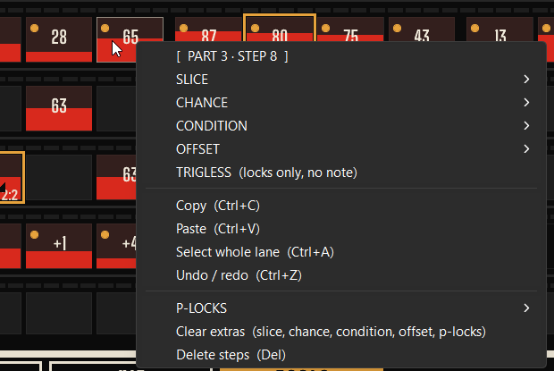

The header says what it acts on (`PART 2 · STEP 13` or `4 STEPS SELECTED`). Items: SLICE, CHANCE, CONDITION, OFFSET, TRIGLESS, copy, paste (the top-left step lands on the clicked step), select whole lane, undo / redo, and at the bottom the removing items: P-LOCKS (remove one or all), clear extras, delete steps.

### Melodic lanes
Play a kick bassline or tuned toms:

1. Set the lane's **PIT** box to a base note (drag up / down, wheel = ±1 semitone).
2. Paint semitones in the **PITCH** view tab (−24 … +24).

Switching PIT on also switches the panel's **Q** (pitch quantize) on for that part, so the volca plays the notes chromatically. PIT off = back to the panel's pitch.

On a PIT lane the panel's PITCH can't be p-locked (the PITCH tab does that job). On a lane with PIT off the PITCH tab can't be painted.

---

## View tabs

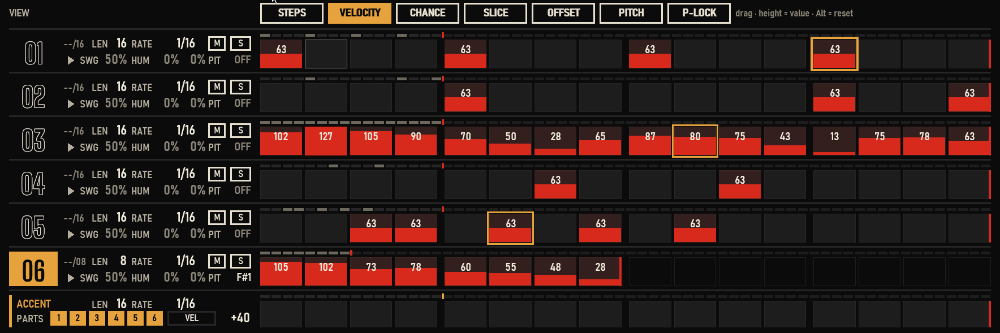

The **VIEW** row above the lanes switches what the steps show:

| Tab | Shows | Range |
|---|---|---|
| **STEPS** | Steps on / off (normal) | |
| **VELOCITY** | Velocity as bars | 1-127 (63 = panel LEVEL) |
| **CHANCE** | How often the step plays | 0-100 % |
| **SLICE** | Hits inside one step | `-`, x2, x3, x4, x6, x8 |
| **OFFSET** | Early / late | −40 … +40 % of a step |
| **PITCH** | Semitones (PIT lanes) | −24 … +24 |
| **P-LOCK** | One panel parameter per step | 0-127 or real units |

**Drag across lit steps: the mouse height sets the value.** Draw a curve in one move. **Alt+drag** = back to default. Double-click a lit step = its default. Empty steps are left alone: place notes in STEPS view.

### P-locks
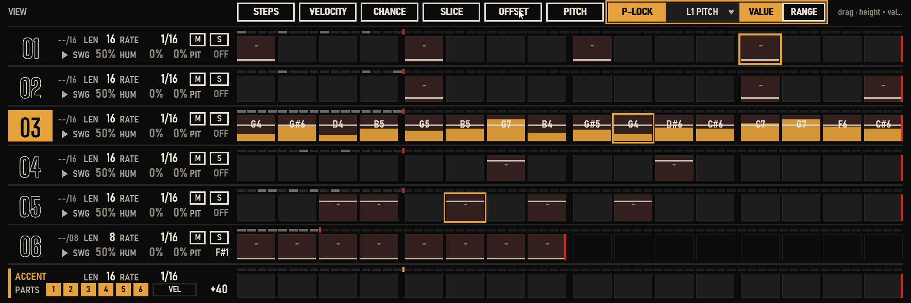

A p-lock gives one step its own value for a panel parameter: kick 13 lower, only the last snare dirty, hat release painted across 16 steps.

1. Click **P-LOCK**, then pick the parameter in the **PARAM** field next to it (▼). 26 parameters: layer 1, layer 2, mix and waveguide.
2. Paint by height. The thin white line = the panel's current value.
3. **Alt+drag** removes locks.

The value goes back to the panel's value after the hit. Level, attack, release, pitch and mod values show real units like the panel (`363ms`, `G#1`). With **LINK** on in the panel, a layer lock goes to both layers.

**VALUE | RANGE** (switch next to PARAM): on **RANGE** you paint a random range instead of a value. Each hit then rolls a new value inside it, a hat whose decay is never the same twice. The cell shows a lighter band and `±n`, a small tick shows the value sent on the last hit.

### Trigless steps
A trigless step plays **no note**. It only sends its p-locks, right on its step time, and changes whatever is still ringing: a long tom that drops in pitch mid-sound, a snare tail that gets dirtier.

Select steps → **TRIGLESS** in the [STEP](#step) tab (or the step menu). Then paint locks for them in P-LOCK view. The step shows **LOCK** and the number of locks (red **0** = no locks yet).

---

## Accent row

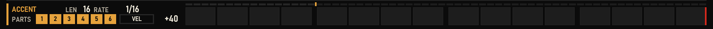

One accent track for the whole kit, under lane 6. A lit accent step pushes every hit of a listening part that falls on it. Give the row its own length and the push **walks**: hats on 16 steps, accent row on 7 steps = the loud hit lands somewhere else every bar.

| Control | What it does |
|---|---|
| **Cells** | Click = on / off, drag = paint, Alt+click = the row ends here. Right-click = presets (on the beats, offbeats, every 3rd, 3-3-2, random) and clear. |
| **LEN / RATE** | Like a lane. |
| **PARTS 1-6** | Which parts listen. Shift+click = all. |
| **PARAM + amount** | What an accent does. **VELOCITY** (default +40) = louder. Any panel parameter can get its own amount (−64 … +64): drive or bit crush that walks with the accent. **NOTE** = PIT lanes jump by semitones on accents. Several parameters can work together. |

A real p-lock on the same step wins over the accent amount.

---

## Bottom strip

Seven tabs: **STEP · GEN · BEAT · FEEL · ROUTE · KIT · TOOLS**.

### STEP
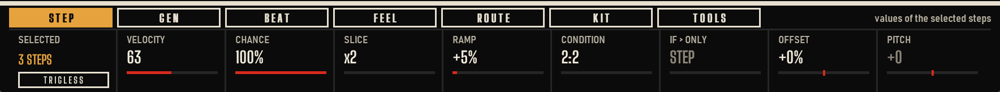

The values of the selected step(s). With several steps selected, VELOCITY and OFFSET move relatively, the others are set for all.

| Field | What it does |
|---|---|
| **VELOCITY** | 1-127, 63 = panel LEVEL |
| **CHANCE** | 0-100 %: a dice roll each time the step comes around |
| **SLICE** | Hits inside one step: x2 … x8 rolls, or rhythmic figures (`o` = hit, `_` = rest, e.g. `o_o`) |
| **RAMP** | −100 … +100 %, with a slice only: **+** = the roll gets louder, **−** = it fades |
| **CONDITION** | When the step plays, see the table below |
| **IF → ONLY** | What the condition decides: **STEP** (whole step), **SLICE** (the roll; the first hit always plays), **P-LOCK** (the locks and step pitch; the note always plays) |
| **OFFSET** | −40 … +40 % of a step, early or late |
| **PITCH** | Semitones on PIT lanes |
| **TRIGLESS** | Lit = the selected steps send only their locks, no note |

#### Conditions
Chance and condition together decide **whether a step plays this time**. A x4 roll at 50 % is a full roll or nothing.

| Condition | Plays when | Use |
|---|---|---|
| `-` | always | normal step |
| `1:2` / `2:2` | odd / even loops of the lane | call and response, the groove changes every other bar |
| `1:4` … `4:4`, `1:8` … `8:8` | loop A of every B | `4:4` = a turnaround hit in the last bar of every 4 |
| `1ST` | only the first loop after play | entry crash |
| `NO 1ST` | every loop except the first | a part that joins from loop 2 |
| `FILL` | only while FILL is on | a snare roll that comes when you press FILL |
| `NO FILL` | only while FILL is off | hits that drop out during the fill |
| `PRE` | the last condition step in the same lane played | step 7 at 50 %, step 8 at `PRE` = both or neither |
| `NO PRE` | that step did **not** play | either-or inside one lane |
| `NEI` | the last condition step of the lane above played | two parts that come together |
| `NO NEI` | that step did **not** play | closed hat at 50 %, open hat at `NO NEI` = one or the other |

`PRE` and `NEI` only look at steps with a chance below 100 % or a real condition. A:B counts the lane's own loops; in SYNC REAPER it counts from project start, so a looped region always plays the same.

**Try this:** snare on steps 5 and 13, steps 14-16 set to `FILL`. Play: only the backbeat. Switch FILL on: 14-16 roll in.

**Bass melodies with variance:** on a PIT lane give a few steps a PITCH, a condition and IF → ONLY = P-LOCK. The note always plays, the melody note only on the loops the condition picks. 16 steps become a 4-bar bassline.

### GEN
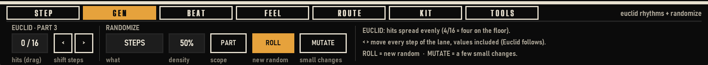

Generators for the **focused lane**.

| Control | What it does |
|---|---|
| **EUCLID · HITS** | Spreads the hits as evenly as possible over the lane, live while you drag: 4/16 = four on the floor, 3/8 = 3-3-2 tresillo. |
| **< >** | Shift all steps (with their values) one step left / right. |
| **RANDOMIZE · WHAT** | **STEPS** (guided by the part: kick on downbeats, snare on 2 and 4, hats on 8ths / 16ths …), **STEPS WILD** (pure random), velocity, chance, slice, offset, the P-LOCK parameter, pitch. |
| **AMOUNT** | How busy / how strong. |
| **SCOPE** | The focused part, or parts 1-n. |
| **ROLL** | New random result. |
| **MUTATE** | Small changes: two steps flip, velocities nudge. |

### BEAT
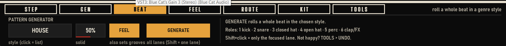

Rolls a complete beat for all six lanes. Every press gives a new variation; undo brings the old one back.

| Control | What it does |
|---|---|
| **STYLE** | 28 styles in 5 groups (click = list, wheel = next) |
| **INTENSITY** | Sparse → solid → busy. From 50 % the styles add their turnarounds and fills (`4:4` snare rolls, `FILL` tom runs) |
| **FEEL** | On = the style also sets grooves, lane swing and lane lengths. Off = only new steps |
| **GENERATE** | All six lanes · **Shift** = only the focused lane |

| Group | Styles |
|---|---|
| **SCENE** | EBM, AGGROTECH, INDUSTRIAL, OLD EBM, FUTUREPOP, RHYTHM NOISE, ELECTRO-IND, COLDWAVE |
| **CLUB** | TECHNO, HOUSE, UK GARAGE, DUB TECHNO |
| **BREAKS + ELECTRO** | ELECTRO, BREAKBEAT, DNB / JUNGLE |
| **URBAN** | BOOM BAP, TRAP, DEMBOW |
| **CLASSIC** | ROCK, DISCO, FUNK, ONE DROP, BOSSA NOVA, SAMBA, SWING, WALTZ 3/4, SHUFFLE 12/8, MARCH |

Lane roles: 1 kick, 2 snare, 3 closed hat, 4 open hat, 5 perc, 6 clap / FX. SWING and SHUFFLE 12/8 use 12 steps at 1/8T (one 4/4 bar in triplets). WALTZ 3/4 needs the project in 3/4.

**Mute trick:** generate one full beat, then arrange by muting lanes.

### FEEL
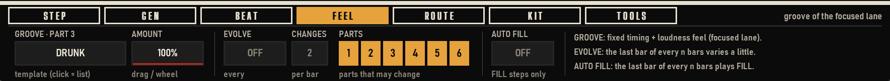

**GROOVE** (focused lane, **Shift** = all lanes): a fixed feel over 16 steps, small timing shifts and some velocity changes, on top of swing and humanize. **AMOUNT** scales it.

| Groove | Feel | Try on |
|---|---|---|
| PUSH | offbeats early, leans forward | hats, sequenced bass |
| LAZY | 2 and 4 late (and a bit louder) | snare, heavy stomp |
| DRUNK | fixed "wrong" shifts | broken-machine percussion |
| MPC 16 | 16th shuffle, late notes softer | hats, shakers |
| SHUFFLE 8 | 8th-note shuffle | toms, claps |
| ACCENT HAT | velocity only: loud, soft, mid, soft | straight 16th hats |
| EBM DRIVE | offbeat accent + slight push | pumping 16th bass line |
| HUMAN | small timing + velocity variation | anything too stiff |

**EVOLVE**: every 1 / 2 / 4 / 8 bars the last bar varies a little (ghost hit, a hit moved, dropped or louder, locks nudged), then the loop comes back. **CHANGES** = 1-3 per evolve bar, **PARTS** = which lanes may change. The pattern itself is never edited.

**AUTO FILL**: every 2 / 4 / 8 / 16 bars the last bar plays as if FILL were on: `FILL` steps fire, the fill pattern plays. Manual FILL still works on top.

### ROUTE
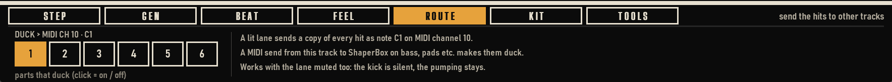

**DUCK 1-6**: lanes with DUCK on also send a trigger (note C1 on MIDI channel 10) on every hit. Other tracks duck to it, sidechain style: bass and pads pump with the kick. It also works on a muted lane: the kick is gone, the pump stays. Shift+click = all off.

> [!TIP]
> **Make other tracks pump:** select them and run the action **Volca duck to selected tracks**. It does the routing in one click. Full setup: [Volca duck to selected tracks](actions.md#volca-duck-to-selected-tracks).

### KIT
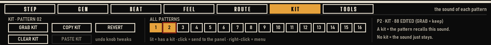

A pattern can bring its own volca sound: verse kit, drop kit, a harsher kit for the last chorus. Switching to that pattern (click, chain, fill pattern, region, program change) sends the stored sound to the panel.

| Control | What it does |
|---|---|
| **GRAB KIT** | Panel → pattern: the current pattern stores the panel's sound |
| **CLEAR KIT** | The pattern forgets its kit (steps stay) |
| **COPY KIT / PASTE KIT** | Kit clipboard. Paste stores the kit and sends it to the panel |
| **REVERT** | Pattern → panel: drops your knob tweaks. GRAB a sound you like, tweak freely, REVERT |
| **ALL PATTERNS 1-16** | Lit = has a kit. Click = hear that kit. Right-click = send / copy / paste / clear |

The line on the right says if the panel still **MATCHES** the stored kit or how many values were **EDITED**. A pattern without a kit keeps the sound that is there. While playing, the next kit goes out shortly before the bar line, so the first hit already has the new sound.

### TOOLS
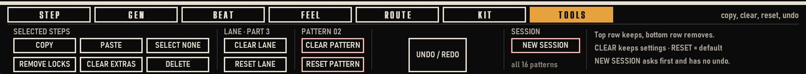

In every group the top row keeps things, the bottom row removes them.

| Group | Top row | Bottom row |
|---|---|---|
| **SELECTED STEPS** | COPY · PASTE · SELECT LANE / SELECT NONE | REMOVE LOCKS · CLEAR EXTRAS · DELETE |
| **LANE · PART n** | CLEAR LANE | RESET LANE |
| **PATTERN nn** | CLEAR PATTERN | RESET PATTERN |
| **UNDO** | UNDO / REDO | |
| **SESSION** | | NEW SESSION |

- **Clear** = the contents go, the settings stay. **Reset** = contents and settings back to default.
- **Extras** = slice, chance, condition, offset, ramp and p-locks of a step (not the note).
- **Undo** reverts the last edit, press again = redo. One level, for the playing pattern.
- **NEW SESSION** empties all 16 patterns, the chain and the global feel settings. The panel sound, sync and look stay. It asks first and **can't be undone**.

---

## Tap record

Play the parts in live while the pattern runs.

1. Arm the track. Play the parts on MIDI channels 1-6 (part 1 = channel 1 …) from a keyboard or pad controller.
2. Click **REC** (red when on). Every hit lands on the nearest step of that part's lane, with its velocity. Existing steps stay. The button counts the hits.
3. Click **REC** again to stop.

**CAL** calibrates your timing: with the pattern playing, click CAL and tap any pad on every beat, 8 times. The box then shows your lateness (e.g. `23ms`) and every recorded hit is pulled that much earlier. Recalibrate after changing the audio buffer. Alt+click = 0 ms.

---

## Reference

### Mouse and keys
| Where | Click | Drag / wheel | Right-click | Alt+click / double-click | Modifier |
|---|---|---|---|---|---|
| Empty step | on | drag = paint | step menu | lane ends here | Ctrl = select, Shift = range |
| Lit step | select / off | drag = erase, wheel = velocity | step menu | lane ends here | Ctrl = select, Shift = range |
| Step in a value tab | | drag = value by height | step menu | default | |
| Value box | | change | value list | default | Shift = all lanes (lane boxes) |
| Part name | focus + test hit | | lane menu | | |
| Pattern slot | select / queue | | pattern menu | | Shift = add to chain |
| M / S | mute / solo | | | | Shift = clear all |

**Del** = delete selected steps · **Esc** = select none.

### Plugin parameters
For automation and MIDI controllers (REAPER's parameter list of the plugin):

| # | Parameter | # | Parameter |
|---|---|---|---|
| 1 | Sync (REAPER / FREE) | 13 | Mute (bit per lane) |
| 2 | Free BPM | 14 | Solo (bit per lane) |
| 3 | Free tempo (project / own BPM) | 15 | Chaos |
| 4 | Free run (play / stop) | 16 | Duck (bit per lane) |
| 6 | Master length | 17 | Tap record |
| 7 | Fill | 18 | Tap record compensation (ms) |
| 8 | Pattern | 19-21 | Evolve every / changes / parts |
| 9 | Swing | 22 | Regions = patterns |
| 10 | Chain | 23 | Auto fill every |
| 11-12 | Color / Look | 24 | Density |

### MIDI
| Direction | What |
|---|---|
| Out, notes | Lanes 1-6 → notes 65 / 67 / 69 / 71 / 72 / 74; the panel puts them on channels 1-6. PIT lanes send the played note on channel 11-16, the panel moves it to channel 1-6. |
| Out, CC | P-locks and accent amounts as the panel's CCs, on the part's channel (see the [panel's CC table](panel.md#midi)) |
| Out, duck | C1 (note 36) on channel 10 for lanes with DUCK on |
| In, notes | Channels 1-6 = tap record for part 1-6 |
| In, program change | 0-15 = switch to pattern 1-16 (not passed on) |

Pattern data is saved with the project. REAPER presets of the sequencer store the whole sequencer state.

---

## Troubleshooting

| Problem | Fix |
|---|---|
| No sound at all | Check the track's MIDI hardware output (volca port, *send to original channels*), and that the port is enabled in Preferences > MIDI Outputs. |
| Only some parts play, or all parts on one sound | The volca must be in split channel mode (part 1-6 = channel 1-6). See the [README](../README.md#volca-setup-split-channel-mode). |
| The volca's own sequencer starts playing along | REAPER sends MIDI clock: in Preferences > MIDI Outputs, switch clock off for the volca port. |
| P-locks or kit per pattern don't work, readout says `PANEL NOT FOUND` | The panel must be on the same track, **after** the sequencer. |
| REGIONS has an orange frame, readout says `REGIONS: NO HELPER` | Run the action **Volca listener (start)** (see [Actions](actions.md)). Regions also need SYNC REAPER. |
| FREE mode stutters or starts late while REAPER is stopped | Arm the track. |
| Readout says `MIDI TIGHT!` | Too many p-locks at the same moment for the MIDI cable. Spread them out or use fewer parameters per step. |
| A value sticks after a p-lock | Press **SEND ALL** in the panel. |
| Pitch locks are grey on a lane | The lane has PIT on: use the PITCH tab there. |
| Ctrl+Z / Ctrl+C don't work in the window | REAPER keeps these keys. Use the right-click menus or TOOLS. |
| The grid shows only steps 1-16 | Lanes longer than 16 steps continue on **PAGE 2-4**. |
| Two projects open, sequencers react to each other | Use one sequencer + panel pair per REAPER session: they share memory across project tabs. |
